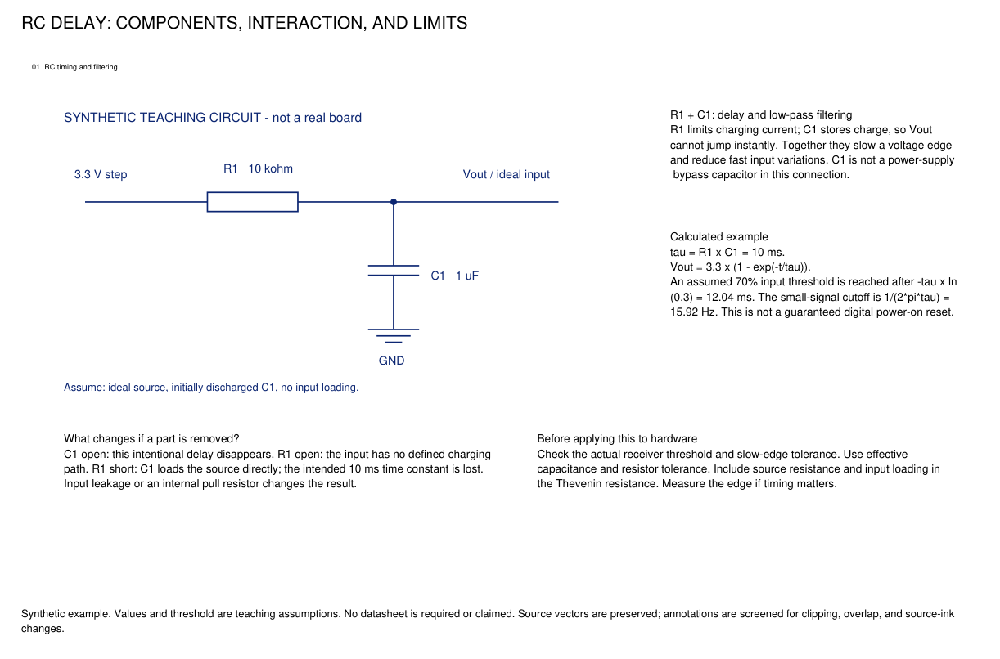

# Schematic Deep Review

An AI skill for understanding electronic schematics through component interactions, power-path analysis, manufacturer evidence, and readable annotated PDFs.

Give your AI the original schematic. The skill guides it from **what the board does** to **why each component is there**, with calculations, matching datasheets, and explanations beside the relevant circuit.

[Download ZIP](https://github.com/CEvildreaming/-schematic-deep-review/archive/refs/heads/main.zip) · [Skill instructions](skills/schematic-deep-review/SKILL.md) · [Standalone method](skills/schematic-deep-review/references/workflow.md) · [Knowledge library](skills/schematic-deep-review/knowledge/index.md)

## Install with an AI

In Codex with Skill Installer available, paste:

```text
Use $skill-installer to install the skill from:
https://github.com/CEvildreaming/-schematic-deep-review/tree/main/skills/schematic-deep-review
```

This is the simplest AI-assisted installation route. The installer must have network and local file access. If the skill does not appear immediately, start a new session.

For another agent, download the repository and ask it to read `skills/schematic-deep-review/SKILL.md`, including the references relevant to your task. Agents differ in skill discovery, local execution, and browsing support; the repository does not make those capabilities available automatically.

## Use it

Attach an original schematic PDF or provide a readable local file, then ask:

```text
Use $schematic-deep-review to analyze this original schematic.
Explain the board's overall function, every component's direct role,
and how neighboring parts work together. Analyze the entire power path,
download matching official datasheets, show useful calculations,
and create readable complete-page annotated PDFs.
Save the results in ./review-output. Write explanations in English.
```

Change the language and output directory as needed. English and Chinese explanations are both supported by the writing workflow; output fonts must contain the required glyphs.

Useful optional inputs are a BOM, native netlist/EDA files, exact part numbers, PCB, supply conditions, and load scenarios. For example: “Check a 3.3 V load stepping from 500 mA to 700 mA for 100 μs, allowing a 0.1 V dip.” Clearly supplied conditions are more useful than an unexplained peak-current number.

A previously annotated drawing can guide style and explanation depth. Electrical conclusions are checked again against the original connections and matching device documents.

## What the reader gets

- **An understandable annotated schematic:** each original schematic page stays complete on one output page, with nearby explanations at a size comparable to the drawing's labels.
- **A separate power explanation:** input selection, protection, regulation, switched domains, capacitors, current/heat boundaries, load transients, and battery/rail ADC measurement.
- **A traceable component inventory:** actual designators, connections, assembly status, roles, sources, and unresolved questions.
- **Manufacturer evidence:** downloaded applicable datasheets, useful excerpts, and explained reference circuits when available.
- **Reproducible calculations and checks:** formulas, inputs, assumptions, coverage, layout checks, and honest validation limits.

The main drawing explains the basic function. Manuals are supporting evidence, not a substitute for explaining what a capacitor, resistor, or switch does.

## Example: explain the interaction, not just the part name

“R1 and C1 form an RC filter” is incomplete. A useful explanation says which node charges, which component responds, and what the numbers mean:

> R1 charges C1, making the control voltage rise gradually. With 10 kΩ and 1 μF, the time constant is 10 ms. Under an ideal supply step, reaching 70% of the final voltage takes 12.04 ms. The same network attenuates fast changes, with a first-order cutoff of 15.92 Hz. Actual enable timing also needs the input threshold, supply ramp, and discharge path.

The repository contains a runnable **synthetic teaching example**, not a real board or a manufacturer's reference design:



```bash
python examples/synthetic-rc/run.py
```

It creates an original vector drawing, an annotated PDF, and checks under `examples/synthetic-rc/output/`. See [the example notes](examples/synthetic-rc/README.md) for its exact scope.

## Install manually

Python 3.10 or newer is required for the helper scripts. From a downloaded or cloned repository, install the skill with:

```bash
python install.py
```

The installer downloads the public GitHub archive and installs only the skill folder. Its default destination is `~/.agents/skills/schematic-deep-review`, following the current [Codex skill discovery documentation](https://learn.chatgpt.com/docs/build-skills). It refuses to overwrite an existing skill.

For an offline installation from an already downloaded repository ZIP:

```bash
python install.py --zip ./downloaded-repository.zip
```

Replace the ZIP filename with the downloaded filename. To use a different skills parent directory, including an older installation:

```bash
python install.py --dest ~/.codex/skills
```

The installer copies skill files; it does not install PDF dependencies, fonts, or modify the agent's configuration. See `python install.py --help` for repository, revision, destination, and timeout options. To update an existing installation, review changes and explicitly replace or move the old skill yourself; installation will not silently overwrite it.

## Set up the PDF tools

From the repository root, create a virtual environment, activate it with your platform's usual command, and install:

```bash
python -m venv .venv
python -m pip install -r skills/schematic-deep-review/scripts/requirements.txt
```

The second command must run in the activated environment, or use that environment's Python executable directly. Dependencies include PyMuPDF, NumPy, Pillow, and jsonschema.

Use a local font that supports the output language and permits embedding. No system fonts are bundled. An independent PDF renderer such as Poppler is recommended for final visual inspection; a geometric test alone cannot assess readability.

## Search the knowledge library

The bundled knowledge is independently written text organized for selective reading. It covers common passive parts, RC behavior, supply decoupling, magnetic components, MOSFETs/BJTs, power conversion, MCU support circuits, interfaces, and op-amps. Formulas include assumptions and examples, not universal component-value prescriptions.

```bash
python skills/schematic-deep-review/scripts/knowledge_search.py "LDO thermal"
python skills/schematic-deep-review/scripts/knowledge_search.py "RC" --limit 5 --json
```

Search is local literal keyword matching, not semantic search or automatic translation. Use English queries for the current English library. Results identify files and line numbers; the AI should read the relevant context before applying it.

The [provenance record](skills/schematic-deep-review/knowledge/provenance.md) describes the learning material consulted. Original PDFs, private schematics, personal paths, and correspondence are excluded. These notes teach concepts; the exact device's datasheet remains authoritative for its pins, requirements, and limits.

## Tools and validation

```bash
python skills/schematic-deep-review/scripts/review.py --help
python -m unittest discover -s skills/schematic-deep-review/tests -v
python skills/schematic-deep-review/knowledge/verify_examples.py
python tools/check_release.py
python examples/synthetic-rc/run.py
```

The toolchain supports PDF inspection and excerpt extraction, validated downloads with caching, numerical models, structured inventory validation, coverage reporting, and vector-preserving annotation composition.

The test suite covers calculation/error behavior, inventory identities, PDF validation, source preservation, layout bounds and clipping, installation archive safety, and local knowledge search. The [CI workflow](.github/workflows/tests.yml) runs the configured checks; inspect its actual run status rather than assuming a workflow file means CI has passed.

Read [acceptance criteria](skills/schematic-deep-review/references/acceptance.md) and [validation boundaries](skills/schematic-deep-review/references/forward-test.md). A real-project review still requires tracing actual connections, checking source applicability, inspecting every final PDF page, and reporting missing evidence.

## Scope and limitations

This is an agent workflow with supporting tools, not an automatic schematic-to-netlist engine or electrical certification system. An AI or analyst supplies and verifies the component inventory, connections, explanations, and layout plan.

- Scans, unreadable junctions, missing MPNs, and ambiguous symbols require explicit uncertainty or better inputs.
- Layout checks preserve and screen supplied content; they cannot prove that an analyst's selected regions include every connection.
- No native netlist comparison means no claim of proven electrical equivalence.
- Current ratings alone do not prove full-board capacity; supply paths, heat, dropout, and transient conditions matter.
- Hardware stability, thermal behavior, RF performance, and compliance remain unverified without the corresponding measurements.

Use the user's existing scope and language. A local correction should update the affected region and dependent evidence, not unnecessarily recreate an entire accepted project.

## Contributing and license

Improvements to explanations, formulas, tests, portability, and evidence handling are welcome. Include a small synthetic reproduction for bugs when possible. Do not submit private schematics, credentials, unlicensed manuals, or full copied learning documents.

Original repository code and documentation are available under the [MIT License](LICENSE). Third-party documents, fonts, and dependencies retain their own terms; see [Third-party notices](THIRD_PARTY_NOTICES.md).
